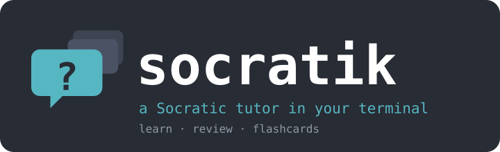
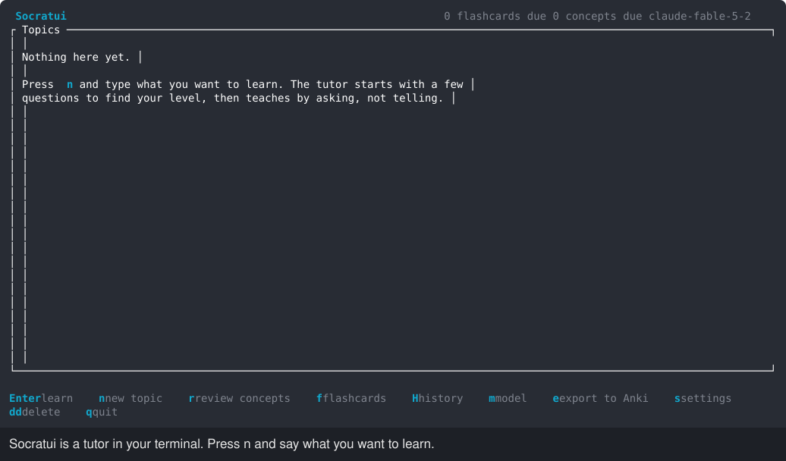
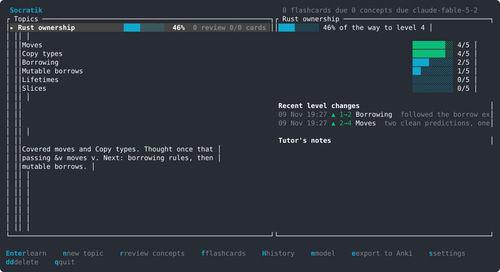
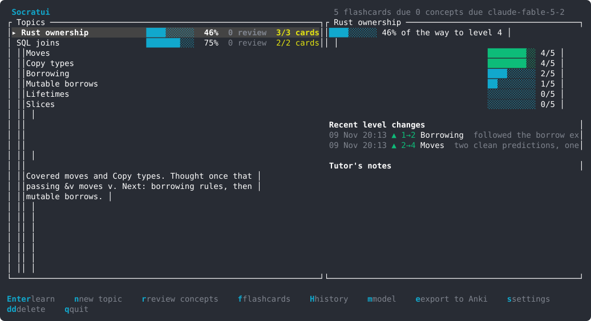
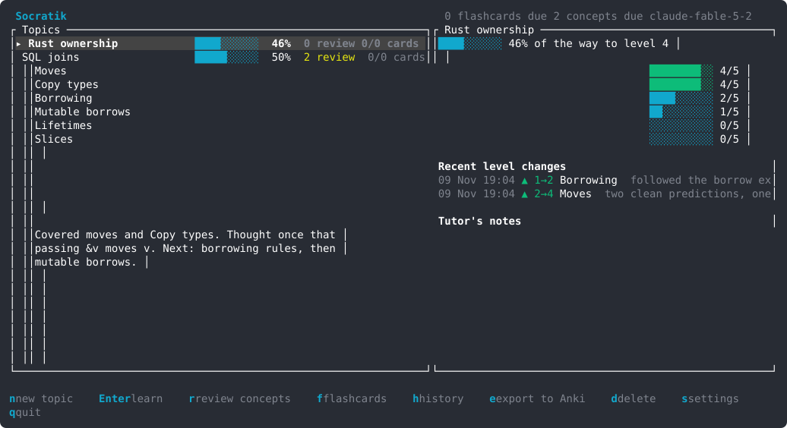
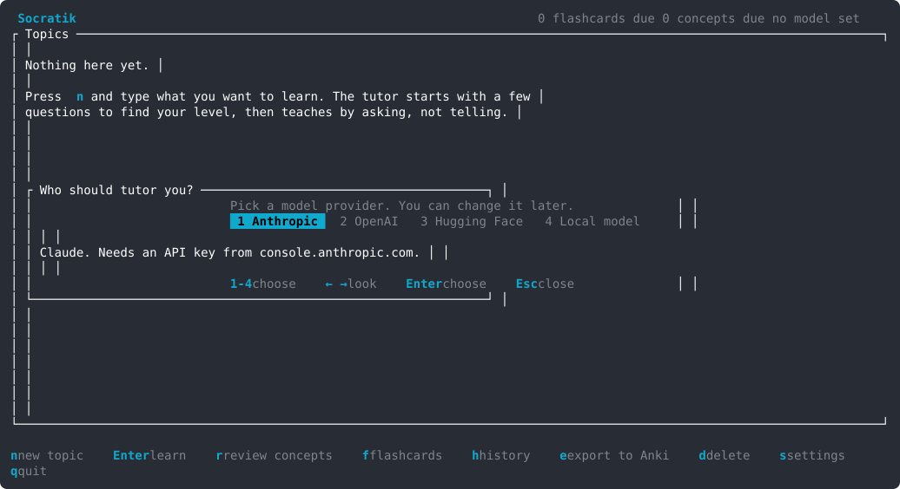

<h1 align="center"></h1>

<p align="center"><b>A tutor in your terminal that teaches by asking, and remembers what you know.</b><br>
A skill map that persists, spaced review by questioning, and flashcards you can take to Anki.<br>
<sub>Linux · Rust · Claude, GPT, open or local models · MIT</sub></p>

Tell Socratik what you want to learn. The tutor splits the topic into subskills and asks a few questions to find your level. Then it teaches by asking, one question at a time. A wrong answer gets a narrower question, and a right one sometimes gets a push-back. Each subskill has a level from 0 to 5 that you earn on evidence. What you work through becomes flashcards. The concepts you've learnt come back on a spaced schedule, and the tutor reviews them with new questions. Everything is kept between sessions, so the next one picks up where you left off.



> [!TIP]
> **Quickest install: paste this into Claude Code and let it do the setup.**
>
> ```text
> Set up Socratik (https://github.com/nodo-labs-uk/socratik) for me.
>
> 1. Install it: download socratik-x86_64-linux.tar.gz from the latest release
>    (https://github.com/nodo-labs-uk/socratik/releases/latest), or clone the
>    repo and run `cargo install --path .`.
> 2. Make sure `socratik` is on my PATH.
> 3. Tell me to run `socratik` in a terminal. On first start it asks which
>    model to use, unless ANTHROPIC_API_KEY, OPENAI_API_KEY or HF_TOKEN is set.
>
> Don't change anything else.
> ```

**Contents:** [Design principles](#design-principles) · [Learning](#learning) · [Flashcards](#flashcards) · [Concept review](#concept-review) · [History](#history) · [Models](#models) · [Keys](#keys) · [Compared with other tools](#compared-with-other-tools) · [Install](#install) · [Files](#files) · [Development](#development) · [Licence](#licence)

## Design principles

- The tutor teaches by asking. It asks one question and waits. A wrong answer gets a narrower question that shows the gap in your reasoning. The tutor explains directly only after two or three tries, then tests the same idea from another angle. A right answer sometimes gets "are you sure?", so you learn to defend it.
- You earn each level. A subskill goes from 0 (unaware) to 5 (can teach it). A level goes up only after two independent correct checks, and one of them must be unprompted. Level 5 needs an edge case handled and a clear explanation. The app logs every change with the reason.
- It remembers you. Topics, levels, sessions and the tutor's own notes live in one SQLite file. A new session starts with the skill map, the notes and the end of the last session. The tutor knows where you were without resending every old conversation.
- Concepts get reviewed as well as cards. Each concept you have learnt comes due on a spaced schedule. A review is a short Socratic session on the due concepts. The tutor grades your recall, which sets the next due date, and lowers the level if you've lost it.
- Flashcards come from your own work. The tutor makes cards from what you have worked through, never from material you haven't met. Review them in the app, or export them to Anki.
- You choose the model: Claude, OpenAI, open models through Hugging Face, or a model on your own machine through llama.cpp.
- The keyboard comes first, and the keys follow vim: `j` `k`, `gg` `G`, `h` back and `l` open, `dd` to delete, and a normal mode in the chat for moving around the lesson. Each screen lists its keys along the bottom.

## Learning

`n` starts a topic: type what you want to learn and choose the aim, level 4 (can do it independently) or level 5 (can teach it). The tutor builds the skill map, runs a short diagnostic, and proposes where to start. `Enter` on a topic continues it, with the tutor picking up from its notes. The skill map beside the chat changes as levels do.



You can say "show progress", "harder", "easier" or "just tell me" at any time. The course ends when every subskill reaches the aim, after a final mixed assessment.

## Flashcards

The tutor saves a card when you have worked through a fact worth memorising, and `Ctrl+F` asks for cards on what you have covered so far. `f` on the home screen reviews every card that is due, across topics. `Space` shows the answer and `1`-`4` grade it (again, hard, good, easy), with the next interval shown on each button. A card you get wrong comes round again before the review ends.

`e` writes every card to `anki-export.txt` in Anki's text format, with a deck per topic (`Socratik::<topic>`) and tags for the topic and subskill. In Anki, use File > Import.



## Concept review

A subskill comes due for review the day after it first reaches level 1, and then on a growing interval. The home screen counts what is due per topic, and `r` reviews that topic's due concepts. The tutor asks one or two recall questions per concept, with no hints, then records a grade: a good answer pushes the next review further out, a miss brings it back sooner and can lower the level.


Cards and concepts share one scheduler, in the style of SM-2: after a first good answer the next review is in 1 day, then 3, then the interval times an ease factor that starts at 2.5. A missed card comes back in 10 minutes, a missed concept the next day.

## History

The home screen shows each topic's progress, its recent level changes with the reasons, and the tutor's notes. `H` lists every session with its token count, and `Enter` opens one to read.



## Models

On first start, Socratik uses the first of `ANTHROPIC_API_KEY`, `OPENAI_API_KEY` or `HF_TOKEN` it finds. With none set, it asks: pick a provider, then paste the key or give the server's address, then confirm the model. `s` opens the same dialog later. The key is saved in a file only you can read.

`m` switches the model from any screen, in the middle of a lesson too. The picker asks the provider which models it offers (for Hugging Face, only those it can run with tool calls), and shows a built-in list until the answer arrives. Type to filter, `Ctrl+N` and `Ctrl+P` move, and `Enter` uses the highlighted model, or the name you typed when nothing matches.




| Provider | Asks for | Default model |
|---|---|---|
| Anthropic | API key | `claude-fable-5-2` |
| OpenAI | API key | `gpt-5.6-sol` |
| Hugging Face | token | `openai/gpt-oss-120b` |
| Local model | server address, `http://localhost:8080/v1` by default | whatever the server loaded |

The tutor changes the skill map, cards and notes through tool calls, so the model must support them. For llama.cpp, start the server with `llama-server -m model.gguf --jinja`. The Local option works with any server that speaks OpenAI's chat completions API without a key, such as Ollama. Small models follow the method less reliably than large ones.

Your conversations go to the provider you choose. With a local model, they stay on your machine. The token count for each session is under the chat. With Anthropic, earlier turns are read from the prompt cache, which costs less than sending them again.

## Keys

The keys follow vim. The chat has two modes, as vim does. It starts in insert mode, where you type your answer. `Esc` switches to normal mode, where keys move around the lesson, and `i` goes back to typing. The answer box says NORMAL while you are in normal mode.

| Key | Where | What it does |
|---|---|---|
| `j` `k` | lists, chat in normal mode | down, up |
| `gg` `G` | lists, chat in normal mode | first, last |
| `l` `Enter` | lists | open |
| `h` `q` `Esc` | other screens, chat in normal mode | back |
| `m` | any screen, chat in normal mode | choose the model |
| `n` | home | new topic |
| `r` | home | review the topic's due concepts |
| `f` | home | review the flashcards that are due |
| `H` | home | session history |
| `e` | home | export every flashcard for Anki |
| `s` | home | provider and key |
| `dd` | home | delete the topic, with its sessions and cards, after a confirmation |
| `q` | home | quit |
| `Enter` | chat, insert mode | send your answer |
| `Alt+Enter`, `Ctrl+J` | chat, insert mode | new line |
| `Ctrl+W` `Ctrl+U` | any text box | delete the word, or the line, before the cursor |
| `Esc` | chat, insert mode | normal mode |
| `i` `a` `A` | chat, normal mode | type: at the cursor, after it, at the end |
| `Ctrl+D` `Ctrl+U` | chat, normal mode | half a page down, up |
| `Ctrl+F` | chat | make flashcards for what you have covered |
| `Ctrl+R` | chat | retry after an error |
| `Space` | flashcards | show the answer |
| `1`-`4` | flashcards | again, hard, good, easy |
| `dd` | flashcards | delete the card, after a confirmation |

The arrows and `PgUp` `PgDn` work too.

## Compared with other tools

| | Socratik | A tutor prompt in a chat | [Anki](https://apps.ankiweb.net) |
|---|---|---|---|
| Teaches by asking questions | ✓ | ✓ | – |
| Skill map with levels | ✓ kept between sessions | for one conversation | – |
| Reviews concepts on a schedule | ✓ by questioning | – | – |
| Flashcards | ✓ made by the tutor | – | ✓ you write them |
| Spaced repetition of cards | ✓ SM-2 style | – | ✓ SM-2 or FSRS |
| Runs in | terminal | chat app | desktop, mobile, web |

Anki is the better place to keep a large deck for years, which is why Socratik exports to it.

## Install

The prompt at the top of this page does this for you. By hand: take the binary from the [latest release](https://github.com/nodo-labs-uk/socratik/releases/latest):

```sh
curl -fsSL https://github.com/nodo-labs-uk/socratik/releases/latest/download/socratik-x86_64-linux.tar.gz | tar xz
install socratik-x86_64-linux/socratik ~/.local/bin/
```

or build it from source with `cargo install --path .`. Then run `socratik`.

## Files

Everything is in `~/.local/share/socratik/`, or in `$SOCRATIK_DATA_DIR` if set:

- `socratik.db`: topics, subskills and levels, every level change, sessions and their messages, and flashcards with their review history.
- `config.json`: the provider, its address, the key and the model, readable only by you.
- `anki-export.txt`: written by `e`.

`SOCRATIK_MODEL` overrides the saved model name for one run.

## Development

`cargo test` runs the tests. `demo/record.py` re-records the videos. It runs the app in a private tmux server, next to a stand-in model server that answers from a script. It needs no API key and costs nothing. Pushing a `v*` tag builds a release.

## Licence

[MIT](LICENSE): use it, change it and share it, for anything.

The tutor's method and much of its prompt come from the [socratic-tutor](https://github.com/janestreet/agent_skills/tree/master/socratic-tutor) skill in Jane Street's [agent_skills](https://github.com/janestreet/agent_skills) (MIT, © 2026 Jane Street Group, LLC). [LICENSE](LICENSE) includes its notice.

---

Socratik was built with [Claude Code](https://claude.com/claude-code). Issues, PRs and other contributions are welcome.
